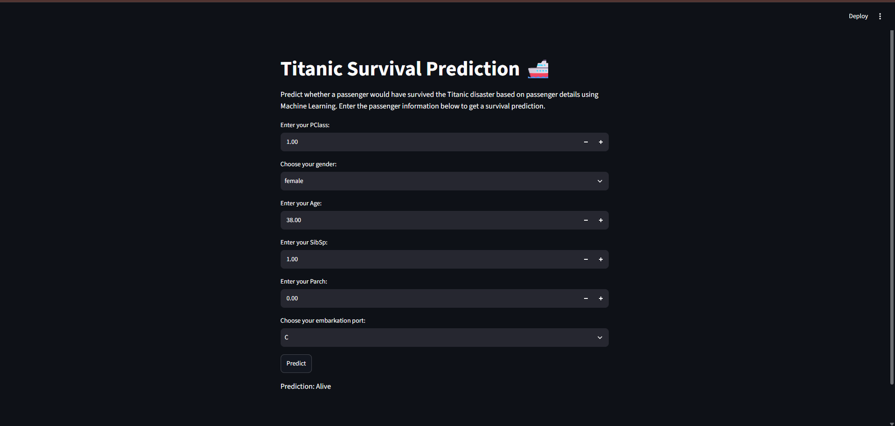

# 🚢 Titanic Survival Prediction

## 📌 Project Overview

This project focuses on predicting passenger survival during the Titanic disaster using Machine Learning.

A Random Forest Classifier is used to predict whether a passenger survived or not based on passenger details.

An interactive web application is developed using Streamlit, allowing users to enter passenger information and receive real-time survival predictions.

## 🎯 Project Objectives

- Analyze the Titanic passenger dataset.
- Perform data preprocessing and exploratory data analysis.
- Build a Machine Learning classification model.
- Predict passenger survival using Random Forest Classifier.
- Deploy the trained model using Streamlit.

## 🛠️ Technologies Used

- Python
- Pandas
- NumPy
- Scikit-learn
- Matplotlib
- Seaborn
- Streamlit
- Joblib / Pickle

## 🤖 Machine Learning Model

**Algorithm:** Random Forest Classifier

**Problem Type:** Binary Classification

**Target Variable:** Survived

The Random Forest Classifier is trained to predict passenger survival based on the available passenger features.

## 📂 Project Structure

```text
Titanic-Survival-Prediction/
│
├── app.py
├── titanic.ipynb
├── model.pkl
├── requirements.txt
├── README.md
│
├── dataset/
│   └── titanic.csv
│
└── screenshots/
    └── titanic_app.png
```

## 📊 Dataset

The Titanic dataset contains passenger information from the Titanic disaster. It is used to train the Random Forest Classifier to predict passenger survival.

**Dataset Features:**
- PassengerId – Unique passenger identification number
- Survived – Survival status (0 = Not Survived, 1 = Survived)
- Pclass – Passenger class
- Name – Passenger name
- Sex – Gender
- Age – Passenger age
- SibSp – Number of siblings/spouses aboard
- Parch – Number of parents/children aboard
- Ticket – Ticket number
- Fare – Ticket fare
- Cabin – Cabin number
- Embarked – Port of embarkation

**Target Variable:** `Survived`

**Dataset File:** `dataset/titanic.csv`

## 🚀 Streamlit Deployment

An interactive Streamlit application is developed to:
- Accept passenger details through user inputs.
- Process the input data.
- Load the trained Random Forest model.
- Generate survival predictions.
- Display the prediction results.

## 💻 How to Run the Project

**Step 1: Clone the repository**

```bash
git clone https://github.com/shamna-nourin/Titanic-Survival-Prediction.git
```

**Step 2: Navigate to the project directory**

```bash
cd Titanic-Survival-Prediction
```

**Step 3: Install the required dependencies**

```bash
pip install -r requirements.txt
```

**Step 4: Run the Streamlit application**

```bash
py -m streamlit run app.py
```

## 📸 Application Screenshot



## 👩‍💻 Author

**Shamna Nourin**

GitHub: [shamna-nourin](https://github.com/shamna-nourin)

---

⭐ If you find this project interesting, feel free to explore the repository!
